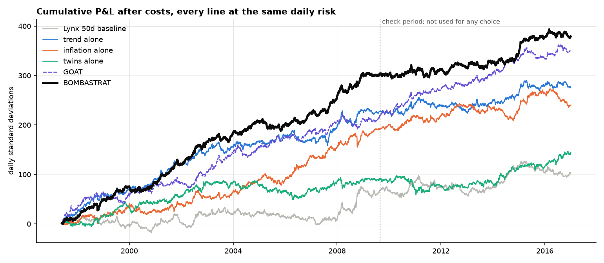
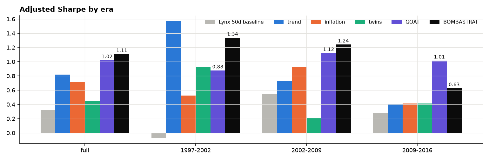
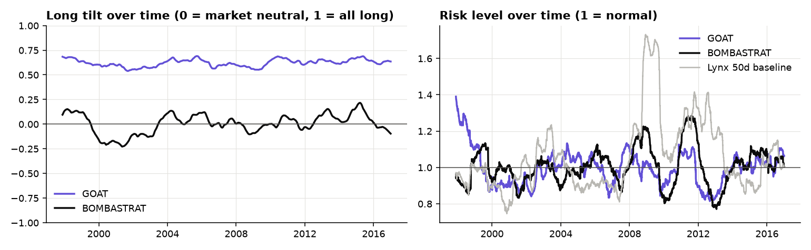

# BOMBASTRAT

**Three simple forecasts, one portfolio, no market bet.** Trend for what trends, inflation for what cares about inflation, twin spreads for what moves together.

| | adjusted Sharpe, full | 1997-2002 | 2002-2009 | 2009-2016 | long tilt | leak test |
|---|---|---|---|---|---|---|
| **BOMBASTRAT** | **1.11** | 1.34 | 1.24 | 0.63 | 0.00 | PASS |
| GOAT | 1.02 | 0.88 | 1.12 | 1.01 | 0.63 | |
| Trend alone | 0.82 | 1.57 | 0.73 | 0.40 | 0.08 | |
| Lynx 50d baseline | 0.32 | -0.07 | 0.55 | 0.28 | 0.02 | |

Lynx evaluator, 2-day lag, costs included. All rows are scored from 1997-05-22, the first day all three forecasts hold positions.
Everything on this page is generated by `build.py`. The whole model is `bombastrat.py` (105 lines of code).



👉 **[VALIDATION.md](VALIDATION.md)**: every stress test we could build before the real out-of-sample data arrives.

## The 2-minute walkthrough

> **What it is.** We make three separate forecasts for each asset and add them up. Nothing else.
>
> **One: trend.** On all 27 assets. If the price has been rising over the last months to a year, we are long; if falling, short. Markets react slowly to news, so moves continue. This is Jaakko's slow trend signal.
>
> **Two: inflation.** On the five bonds and five stocks. Each moon has its own CPI. When a moon's inflation runs hotter than its own three-year normal, we short that moon's bonds and stocks. The story is the textbook one: inflation up, rates up, bond prices down, and stocks get discounted harder. It is positive on all five moons. Inflation moves together across the moons, so think of it as one shared inflation bet more than five local ones.
>
> **Three: twins.** Some commodity pairs are the same thing in two forms, like ore and refined metal. They move together more than 80% of the time. When the gap between them gets unusually wide against its one-year average, we bet on it closing: long the cheap one, short the expensive one.
>
> **How they are put together.** Each forecast gets the same risk budget. We add them, divide by each asset's volatility so every asset carries similar risk, scale the whole book to a constant risk level, and move 30% of the way to the target each day to save trading costs.
>
> **Why three.** They are different bets. Their daily P&L correlations are -0.06, -0.03 and 0.01. Each one alone scores 0.82, 0.72 and 0.45; together 1.11. Take any one away and the score drops.
>
> **What it is not.** It is not a bet that markets go up. The average long tilt is 0.00. It is not fitted: every number in the code was fixed before we scored it, and the one choice we made on data used 1997 to 2009 only.
>
> **Where it is weak.** The last era, 2009-2016, is the softest at 0.63, and the twins part leans on one pair. We show both below.

## How the layers fit

```
Layer 1  SIGNALS      trend (27 assets)   inflation (10 assets)   twins (pairs by rule)
                           |                     |                      |
Layer 2  RISK BUDGET  each forecast divided by the volatility of its own P&L   -> equal risk each
                           +---------------------+----------------------+
                                                 |  add
Layer 3  SIZING       position = forecast / asset volatility                   -> similar risk per asset
                      whole book scaled to constant forecast risk              -> stable total risk
Layer 4  EXECUTION    move 30% toward target each day                          -> low costs, 2-day lag is harmless
```

No overlays, no caps, no stops, no deadband. Each layer does one job.

## Against Lynx's grading criteria

Quotes are from `lynx_materials/lynx-hackathon-instructions.pdf`.

| What Lynx says | What we do | Evidence |
|---|---|---|
| "evaluated based on the net Adjusted Sharpe Ratio" | Three uncorrelated forecasts in one book | **1.11** full (1.34 / 1.24 / 0.63 by era). Lynx baseline 0.32. 18 of 20 calendar years positive |
| "penalty terms that disincentivize negative skewness and high kurtosis" | tanh on every forecast, constant book risk, glide | Skew -0.07, kurtosis 4.12 (normal is 3). The penalty costs 0.10 |
| "forward-looking-bias ... leads to automatic disqualification" | Only trailing windows. No full-sample statistic anywhere | **PASS** on both tests Lynx describes: shorter history, and future data replaced by random data. Difference 0e+00 |
| "two-day lag between calculating a desired position and actually receiving a return" | Slow signals | One extra day of lag changes Sharpe from 1.20 to 1.19 |
| "total portfolio risk ... contributed to in equal parts from all assets" | position = forecast / volatility | Stocks and bonds carry 47% of the risk (37% if perfectly even; GOAT 79%). 22 of 27 assets make money |
| "total risk of your portfolio ... not change too drastically over time" | Book scaled to constant forecast risk every day | Yearly risk stays between 0.77x and 1.28x of normal (Lynx baseline up to 1.73x) |
| "trade-off between alpha decay and transaction costs" | 30% glide | Holding 39 days. Costs take 0.09 Sharpe (1.29 gross, 1.20 net). At double costs the score is 1.04 |
| "a mechanism that would plausibly work in practice" | Slow reaction (trend), inflation and rates (macro), same goods in two forms (twins) | Long tilt 0.00: none of the score comes from markets going up. With every price path flipped upside down, our trend part scores 0.87 (real data 0.82); GOAT scores 0.13 (real data 1.02) |
| "no information about the period it will be judged on" | Parameters fixed up front. One choice on data (twins in or out), made on 1997-2009 only | Neighbouring settings score about the same (tables below). The last simplification (removing three risk caps) changed the 1997-2009 score by -0.01: done for simplicity, not for score |
| "Trend following, reversion and the use of macroeconomic data are all viable" | One simple rule from each family | Remove trend: 0.86. Remove inflation: 0.92. Remove twins: 1.01. All three earn their place |
| "better off developing a simple strategy and properly fine-tuning it" | Three rules, four layers, no overlays | `bombastrat.py`: 105 lines of code, a handful of fixed numbers, all at the top of the file |
| "you will be asked to explain your strategy, how you arrived at it and the code" | One file, one function per forecast | The walkthrough above. History of what we tested and dropped: `research/eemil/final_combined/` |
| "We reward performance, not originality" | Textbook signals | Beats trend alone in 96% of 2000 bootstrap resamples (difference 0.29, 90% interval 0.01 to 0.57) |



## BOMBASTRAT or GOAT?

| | BOMBASTRAT | GOAT |
|---|---|---|
| Adjusted Sharpe, full | 1.11 | 1.02 |
| By era (1997-2002 / 2002-2009 / 2009-2016) | 1.34 / 1.24 / 0.63 | 0.88 / 1.12 / 1.01 |
| On 1997-2009 (the period we allow ourselves to choose on) | 1.29 | 1.03 |
| Long tilt (0 = neutral) | 0.00 | 0.63 |
| Share of risk in stocks and bonds | 47% | 79% |
| Kurtosis | 4.12 | 4.18 |
| Holding, days | 39 | 60 |
| Score if every price path is flipped upside down | trend part: 0.87 (the macro part cannot be flipped) | 0.13 |
| Uses the macro data | yes | no |
| P(BOMBASTRAT scores higher), bootstrap | 65% | |

**Honest reading.** On score alone the two cannot be told apart (90% interval of the difference: -0.28 to 0.45). GOAT is steadier in 2009-2016 because it is long stocks and bonds, which kept rising. BOMBASTRAT reaches a similar full-period score with no such bet, and scores higher on the two earlier eras. If the out-of-sample period has falling stocks or bonds, BOMBASTRAT is the safer submission; if they keep rising, GOAT is.



## Volatility scaling and leverage

**Leverage does not change the score.** Sharpe is return divided by risk, so doubling every position doubles both. What matters is that the risk level stays even, because swings in risk create fat tails, and fat tails are penalised.

We tested whether a different volatility estimate or risk target gains anything. It does not: no version beats the first row, and most land within 0.03 of it, so we keep it and do not tune it.

| version | full | 1997-2002 | 2002-2009 | 2009-2016 | kurtosis | holding d | yearly risk range |
|---|---|---|---|---|---|---|---|
| as built: blended asset vol, book scaled to constant forecast risk (250d covariance) | 1.11 | 1.34 | 1.24 | 0.63 | 4.12 | 38.66 | 0.77 to 1.28 |
| asset vol: Lynx's 100-day window | 1.08 | 1.26 | 1.14 | 0.71 | 4.26 | 39.39 | 0.77 to 1.34 |
| asset vol: fast (EWMA 20 days) | 1.10 | 1.38 | 1.28 | 0.56 | 4.07 | 34.34 | 0.79 to 1.24 |
| asset vol: slow (500-day window) | 1.04 | 1.21 | 1.13 | 0.68 | 4.13 | 40.04 | 0.77 to 1.34 |
| book risk: none (1/vol only) | 1.09 | 1.39 | 1.16 | 0.72 | 4.62 | 39.90 | 0.75 to 1.22 |
| book risk: Lynx's method (trailing 100d P&L std) | 1.08 | 1.43 | 1.24 | 0.58 | 4.58 | 38.86 | 0.84 to 1.12 |
| book risk: covariance over 125 days | 1.09 | 1.41 | 1.17 | 0.60 | 4.09 | 38.62 | 0.84 to 1.17 |
| book risk: covariance over 500 days | 1.09 | 1.40 | 1.21 | 0.61 | 4.32 | 38.60 | 0.74 to 1.40 |
| book risk: covariance of weekly changes (holiday-proof) | 1.07 | 1.34 | 1.18 | 0.57 | 4.15 | 38.28 | 0.75 to 1.30 |
| glide 10% per day | 1.11 | 1.44 | 1.14 | 0.69 | 4.22 | 64.60 | 0.77 to 1.32 |
| glide 100% (no smoothing) | 1.02 | 1.28 | 1.22 | 0.52 | 4.03 | 17.81 | 0.77 to 1.26 |

## Is the inflation lookback a lucky pick?

| bonds, days | stocks, days | as built | full | 1997-2002 | 2002-2009 | 2009-2016 |
|---|---|---|---|---|---|---|
| 20 | 120 |  | 1.11 | 1.36 | 1.29 | 0.64 |
| 60 | 120 | yes | 1.11 | 1.34 | 1.24 | 0.63 |
| 120 | 120 |  | 1.02 | 1.30 | 1.11 | 0.48 |
| 60 | 250 |  | 1.07 | 1.18 | 1.18 | 0.70 |

## Known weak spots

1. **2009-2016 is the softest era** (0.63). Every part is weaker there, not one in particular.
2. **The twins part leans on one pair.** Without beryllium the model scores 0.87 (1.29 / 1.06 / 0.22). The five most important assets carry 37% of the risk (19% if perfectly even).
3. **The gain over trend alone is likely, not certain**: 90% interval 0.01 to 0.57.
4. **The inflation rule is one shared bet, not five local ones.** It works just as well with another moon's CPI, and dies with year-old CPI (`VALIDATION.md`, section 1). The timing is real; the moon-by-moon story is not.
5. **We saw all three eras while building it.** The parameters were set up front and the choices were judged on 1997-2009, but the team has looked at 2009-2016 many times. Only the out-of-sample period is a clean test.

## Run it

```bash
python BOMBASTRAT/bombastrat.py --prices data/close_prices_insample.csv <out_of_sample_prices.csv> \
                                --macro  data/macro_data_insample.csv  <out_of_sample_macro.csv> \
                                --out    BOMBASTRAT/positions.csv
python BOMBASTRAT/build.py      # rebuilds this page, the charts and positions_insample.csv
```

| file | what |
|---|---|
| `bombastrat.py` | the model |
| `build.py` | every number and chart on this page |
| `validate.py`, `VALIDATION.md` | placebos, bootstraps, reshuffled histories, random asset sets, lag, costs, damaged data, and why 2009-2016 is softer |
| `positions_insample.csv` | positions for the full in-sample period, Lynx format |
