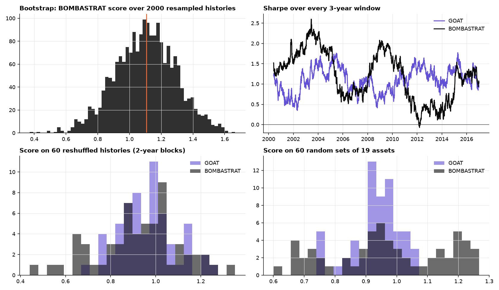

# BOMBASTRAT validation

Generated by `BOMBASTRAT/validate.py`, do not edit by hand. Adjusted Sharpe from Lynx's evaluator unless a column says otherwise, scored from 1997-05-22.

**The real out-of-sample file is not released yet. Nothing below is a true out-of-sample score.** These are the strongest stand-ins we can build from the in-sample data. GOAT is shown next to BOMBASTRAT wherever the test applies to both.

## Summary

| test | result | verdict |
|---|---|---|
| Inflation with stale CPI (1 year old) | -0.14 against 0.72 real | **Pass**: the timing carries the edge |
| Inflation with another moon's CPI | 0.52 to 0.81 against 0.72 real | **Fail as a local story**: it is a shared inflation factor, not moon by moon. Say so in the pitch |
| Inflation rule on each moon alone | positive on 5 of 5 moons | Pass |
| Twins rule on random non-twin pairs | -0.06 on average, best 0.21, against 0.45 real | **Pass**: it works because they are twins |
| Bootstrap, full period | 90% interval 0.78 to 1.41 | Pass: clearly above zero; the exact level is uncertain |
| Every 3-year window | worst -0.07, 85% above 0.5 (GOAT: worst 0.35, 98%) | GOAT is steadier window by window |
| 60 reshuffled histories | average 0.92, 5% low 0.65 (GOAT 0.96, 0.76) | Pass, level with GOAT |
| 60 random sets of 19 assets | average 0.97, worst 0.60 (GOAT 0.94, 0.74) | Pass, but wider spread than GOAT |
| 5 more days of lag / 3x costs | see section 8 | Pass: slow signals |
| Price jumps in the data | see section 9 | BOMBASTRAT loses about half; GOAT breaks |
| Recipe chosen year by year without hindsight | see section 10 | Always holding all three beats picking the past winner |

## 1. Inflation placebos
If the inflation rule is real and local, giving a moon the wrong moon's CPI, or stale CPI, should kill it. Stale CPI does kill it. The wrong moon's CPI does not: inflation moves together across moons (average correlation of 60-day CPI growth between moons: 0.48), so the rule is closer to one shared inflation bet than five local ones.

| inflation data used | inflation alone, full | 1997-2002 | 2002-2009 | 2009-2016 | whole model, full |
|---|---|---|---|---|---|
| real: each moon's own CPI | 0.72 | 0.52 | 0.92 | 0.41 | 1.11 |
| placebo: CPI of the moon 1 place(s) along | 0.52 | 0.34 | 0.61 | 0.53 | 1.00 |
| placebo: CPI of the moon 2 place(s) along | 0.78 | 0.07 | 0.87 | 1.02 | 1.15 |
| placebo: CPI of the moon 3 place(s) along | 0.81 | 0.79 | 0.75 | 0.91 | 1.13 |
| placebo: CPI of the moon 4 place(s) along | 0.66 | 0.23 | 0.66 | 0.93 | 1.07 |
| placebo: own CPI, but 250 trading days stale | -0.14 | -0.31 | 0.03 | -0.18 | 0.66 |
| placebo: own CPI, but 500 trading days stale | -0.07 | -0.34 | 0.15 | -0.11 | 0.72 |
| all moons get the average CPI (is it one global inflation?) | 0.72 | 0.23 | 0.81 | 0.82 | 1.10 |

## 2. Twins placebo
The same spread rule on 3 random commodity pairs that are NOT twins, 40 draws. If twins work because they are twins, random pairs should score about zero.

| pairs | twins alone, full score |
|---|---|
| real twins (found by the correlation rule) | 0.45 |
| random non-twin pairs, average | -0.06 |
| random non-twin pairs, best of 40 | 0.21 |
| share of random draws that beat the real twins | 0% |

## 3. Inflation rule, one moon at a time
The rule on a single moon's bond and stock only.

| moon | full | 1997-2002 | 2002-2009 | 2009-2016 |
|---|---|---|---|---|
| ganymede | 0.44 | 0.38 | 0.99 | -0.25 |
| io | 0.30 | -0.08 | 0.49 | 0.36 |
| titan | 0.61 | 0.47 | 0.62 | 0.67 |
| callisto | 0.13 | -0.48 | 0.39 | 0.24 |
| europa | 0.69 | 0.85 | 0.80 | 0.41 |

## 4. Block bootstrap of the daily P&L
2000 resamples per row. Longer blocks keep more of the slow structure.

| block length | BOMBASTRAT 90% interval | P(score > 0.5) | P(score > 0) | GOAT 90% interval | P(beats trend alone) | P(beats GOAT) |
|---|---|---|---|---|---|---|
| 20 days | 0.78 to 1.42 | 100% | 100.0% | 0.68 to 1.32 | 95% | 65% |
| 60 days | 0.78 to 1.41 | 100% | 100.0% | 0.69 to 1.31 | 96% | 65% |
| 120 days | 0.80 to 1.38 | 100% | 100.0% | 0.72 to 1.28 | 97% | 65% |
| 250 days | 0.80 to 1.39 | 100% | 100.0% | 0.75 to 1.25 | 97% | 64% |

## 4b. Bootstrap inside each era
A 7-year era is short: the intervals are wide for both models.

| era | BOMBASTRAT | 90% interval | P(> 0) | GOAT | 90% interval |
|---|---|---|---|---|---|
| 1997-2002 | 1.34 | 0.82 to 2.15 | 100% | 0.88 | 0.18 to 1.37 |
| 2002-2009 | 1.24 | 0.74 to 1.69 | 100% | 1.13 | 0.53 to 1.63 |
| 2009-2016 | 0.64 | 0.03 to 1.23 | 96% | 1.01 | 0.50 to 1.42 |

## 5. Every 3-year window
Sharpe over each rolling 3-year window (about 4,000 overlapping windows).

| model | worst | 10% low | median | best | windows above 0 | windows above 0.5 |
|---|---|---|---|---|---|---|
| BOMBASTRAT | -0.07 | 0.40 | 1.26 | 2.60 | 100% | 85% |
| GOAT | 0.35 | 0.67 | 1.11 | 1.77 | 100% | 98% |
| trend alone | -0.20 | 0.19 | 0.81 | 2.29 | 98% | 71% |

## 6. Other histories
60 new 22-year histories made by putting random 2-year blocks of the real history (prices and CPI together, all assets at once) in a new order, and running each model from scratch on each. The joins break trends and spreads, so scores are lower than on the real path; the spread of outcomes is the point.

| model | average | 5% low | median | 95% high | histories above 0.5 | histories above 0 |
|---|---|---|---|---|---|---|
| BOMBASTRAT | 0.92 | 0.65 | 0.94 | 1.20 | 98% | 100% |
| GOAT | 0.96 | 0.76 | 0.96 | 1.16 | 100% | 100% |
| BOMBASTRAT higher than GOAT on the same history | 48% |  |  |  |  |  |

## 7. Random 19 of the 27 assets
60 draws. Each model is rebuilt on the smaller universe. A model that needs a few lucky assets shows a wide spread and a low floor.

| model | average | worst | 5% low | median | best | draws above 0.5 |
|---|---|---|---|---|---|---|
| BOMBASTRAT | 0.97 | 0.60 | 0.68 | 0.96 | 1.27 | 100% |
| GOAT | 0.94 | 0.74 | 0.77 | 0.94 | 1.07 | 100% |

## 8. Slower execution and higher costs
Adjusted Sharpe, full period.

| model | as is | +1 day lag | +3 days | +5 days | 2x costs | 3x costs | 5x costs |
|---|---|---|---|---|---|---|---|
| BOMBASTRAT | 1.11 | 1.10 | 1.09 | 1.06 | 1.04 | 0.97 | 0.82 |
| GOAT | 1.02 | 1.01 | 0.99 | 0.95 | 0.99 | 0.97 | 0.92 |

## 9. Damaged data
Real data: BOMBASTRAT 1.11, GOAT 1.02. The out-of-sample file may differ from the in-sample one in ways we cannot see yet.

| damage | BOMBASTRAT | GOAT |
|---|---|---|
| 9 assets only start 40% into the file | 1.11 | 0.98 |
| 2% of prices missing at random | 0.89 | 1.01 |
| an 8-sigma price jump about once per asset-year | 0.60 | -6.35 |
| all prices shifted so they cross zero | 1.10 | 1.01 |

## 10. Walk-forward choice of the recipe
Each January from 2002, pick the combination with the best score on all earlier years, trade it for that year. No hindsight is involved in the first row.

| rule | adjusted Sharpe over the walk-forward years | years 'all three' was the pick |
|---|---|---|
| pick the best past combination each year | 0.77 | 7 of 15 |
| always all three (BOMBASTRAT) | 1.01 |  |

## 11. Where the P&L came from, by asset class and era
Yearly P&L of each class inside BOMBASTRAT, in units of the model's yearly risk. The columns add up to roughly the model's Sharpe in that era.

| class | 1997-2002 | 2002-2009 | 2009-2016 |
|---|---|---|---|
| bonds | 0.25 | 0.53 | 0.32 |
| stocks | 0.33 | 0.42 | 0.17 |
| fx | 0.10 | 0.18 | 0.02 |
| commodity | 1.10 | 0.40 | 0.23 |

## 11b. What changed in the market
Trend strength = average size of the 12-month move in volatility units (a random walk gives about 0.8). Correlation = average between all pairs of assets, weekly. Inflation signal: its average size, and how well it lined up with the next 60 days' move (rank correlation).

| era | trend strength, all | trend strength, commodities | trend strength, stocks+bonds | average correlation | inflation signal size | inflation signal hit (IC) |
|---|---|---|---|---|---|---|
| 1997-2002 | 0.98 | 1.05 | 0.97 | 0.04 | 0.63 | 0.20 |
| 2002-2009 | 0.86 | 0.81 | 0.89 | 0.09 | 0.59 | 0.21 |
| 2009-2016 | 0.85 | 0.79 | 0.93 | 0.09 | 0.53 | 0.09 |

## 11c. Each part by era

| part | 1997-2002 | 2002-2009 | 2009-2016 |
|---|---|---|---|
| trend alone | 1.57 | 0.73 | 0.40 |
| inflation alone | 0.52 | 0.92 | 0.41 |
| twins alone | 0.93 | 0.21 | 0.41 |
| BOMBASTRAT | 1.34 | 1.24 | 0.63 |
| GOAT | 0.88 | 1.12 | 1.01 |
