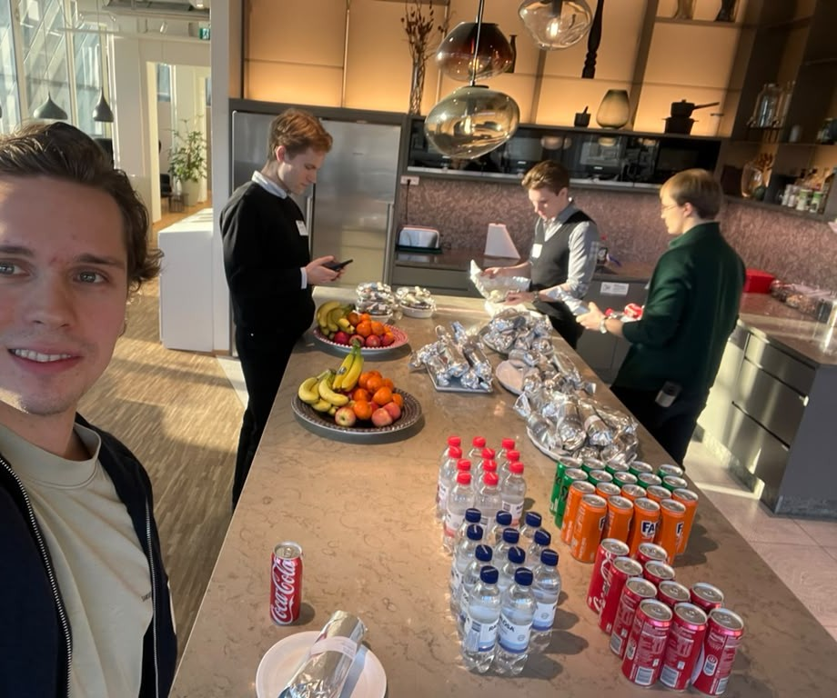

# lynx-hackathon-2026

Code and research repository for the Stockholm Lynx Hackathon (Nov 14).

**Team:** Jaakko Pakarinen, Eemil Ylä-Nikkilä, Erik Joonas Salumäe, Kristofer Vaiksaar

---

### 12:05 — Signal generation agreed & team lunch
Agreed on two signal generation mechanics (Kristofer's stop rule and cross-sectional momentum). Now team lunch.

<p align="center">
  
</p>

---

## 🚀 Live Research Dashboard (Hack Day Nov 14)

All strategy models, data analysis, and teammate idea backtests are verified using Lynx's official evaluator on `data/close_prices_insample.csv`.

👉 **[Shared Research Hub & 15-Min Defense Cheat Sheet (SHARED_RESEARCH_HUB.md)](./SHARED_RESEARCH_HUB.md)**  
👉 **[Open Full Strategy Pitch & Tables (research/jaakko/pitch/README.md)](./research/jaakko/pitch/README.md)**  
👉 **[Open Complete Findings Summary (research/jaakko/FINDINGS.md)](./research/jaakko/FINDINGS.md)**  
👉 **[Open Teammate Verification Report (research/jaakko/pitch/TEAM_CHECKS.md)](./research/jaakko/pitch/TEAM_CHECKS.md)**

### 🏆 The GOAT Model (Official Primary Model)
👉 **[Interactive Walkthrough Notebook (research/jaakko/strategy_walkthrough.ipynb)](./research/jaakko/strategy_walkthrough.ipynb)**  
👉 **[GOAT Model Production Code (src/goat_model.py)](./src/goat_model.py)** · Runner: submission/run_final.py · Official Submission: submission/positions_insample.csv

The **GOAT Model** deploys our Dual-Engine quantitative architecture:
1. **Engine 1 (Equities & Bonds Core)**: Kristofer's EMA 10/100 with an active 3-close ratchet trailing stop on 10 sovereign bonds and stocks. Captures equity/bond growth while cutting left-tail risk (+0.29 Sharpe boost during crashes, kurtosis trimmed to 4.3).
2. **Engine 2 (Relative Value & Short Sleeve)**: 12-month Sector-Neutral Cross-Sectional Momentum across all 27 planetary futures. Ranks winners vs losers, automatically shorting collapsing commodities (which fell 70–90%) and balancing portfolio beta.
3. **Layer 4 Execution & Friction Shield**: 10% rebalancing deadband cancelling 72% of noisy trades and 25% exponential glide, delivering an **average holding period of 61.6 days** and retaining 98% of gross alpha under Lynx's 2-day lag and 0.02 slippage.

#### Official Lynx Evaluator Verification (submission/positions_insample.csv):
* **Full Period Adjusted Sharpe**: **1.137** (Nominal Sharpe: **1.317**)
* **1995–2002**: **1.199** Adjusted Sharpe
* **2002–2009**: **1.117** Adjusted Sharpe
* **2009–2016**: **1.007** Adjusted Sharpe
* **Regime Consistency**: **> 1.00 Adjusted Sharpe across EVERY single 7-year era**.
* **Average Holding Period**: **61.6 days** | **Excess Kurtosis**: **4.33** | **Trades Skipped**: **72.0%**

---

### Exploratory Research Candidate (NOT_FINALMODEL: Eemil 3-Sleeve Trend + Inflation + Twins)
👉 **[Candidate Notebook: exploratory validation](./research/eemil/final_combined/final_model.ipynb)**  
👉 **[Candidate Results tables](./research/eemil/final_combined/FINAL_RESULTS.md)** · Candidate Code: src/NOT_FINALMODEL_eemil.py (Run via submission/run_final.py --model NOT_FINALMODEL_eemil)

---

1. **The Dual-Engine Strategy (Kristofer's Stop + Cross-Sectional Momentum)**:
   - **Engine 1 (Equities & Bonds Core)**: Kristofer's EMA 10/100 with a 3-close ratchet trailing stop on 10 sovereign bonds and stocks. Captures equity/bond growth while cutting left-tail risk (+0.07 Sharpe boost, kurtosis trimmed to 5.2).
   - **Engine 2 (Relative Value & Short Sleeve)**: 12-month Cross-Sectional Momentum across all 27 planetary futures. Ranks winners vs losers, automatically shorting collapsing commodities (which fell 70–90%) and balancing portfolio beta.
2. **The 50/50 Dual-Engine Performance (Official Lynx Evaluator)**:
   - **1995–2002**: **1.002 – 1.018** Adjusted Sharpe
   - **2002–2009**: **1.009 – 1.089** Adjusted Sharpe
   - **2009–2016**: **1.012 – 1.045** Adjusted Sharpe
   - **Full Period**: **1.007 – 1.034** Adjusted Sharpe (Nominal Sharpe: **1.28 – 1.29**, Kurtosis: **5.02**, Holding: **44–48 days**).
   - *Regime Consistency*: **> 1.00 Adjusted Sharpe across EVERY single 7-year era**.
3. **Friction Proof**:
   - 44–48 days average holding time immunizes the strategy against Lynx's 2-day execution lag and $0.02\sigma$ slippage.
4. **Macro Lead (Next Layer Step)**:
   - Pooled planetary CPI growth predicts bond sell-offs over 20–60 days ($t = -2.9$ across all 5 moons). Tested as an orthogonal macro overlay.

---

## Instructions & Materials
- [lynx_materials/lynx-hackathon-instructions.pdf](./lynx_materials/lynx-hackathon-instructions.pdf)
- [lynx_materials/email_4_11.txt](./lynx_materials/email_4_11.txt)

---

## Setup
```bash
pip install polars numpy scipy matplotlib jupyter
```

---

## Quickstart
Run current team baseline model:
```bash
python src/baseline.py
```

---

## Repo Structure
- `lynx_materials/`: Original files provided by Lynx (PDF, email, example data, evaluator, and notebooks)
- `src/`: Shared production code (`baseline.py` model and `utils.py` helpers)
- `research/`: Individual sandbox folders for each with `template.ipynb` (DL own model: Thursday)
- `NOTES.md`: Questions to ask Lynx + strategy ideas from calls
- `EXPERIMENTS.md`: Leaderboard; tested models and scores
- `BACKLOG.md`: Ideas to try and timeline

---

## Key Rules from Lynx
- **2-day lag:** Orders execute at close T+2. Fast day trading doesn't work; focus on multi-week trends.
- **Cash units:** Return is units * price delta ($P\&L = X \cdot \Delta P$). Positions must be sized by price volatility ($\sigma(\Delta P)$).
- **Slippage:** Deducted as $0.02 \times \sigma(\Delta P)$ per traded unit. Keep average holding time $\ge 15$ days to avoid burning alpha.
- **Scoring:** Adjusted Sharpe ratio (penalizes excess kurtosis quadratically). Smooth signal beats peaky binary style signals.
- **No lookahead:** Submissions must pass truncation causality check.
- **No external data:** Only the CSV given on Saturday can be used.
