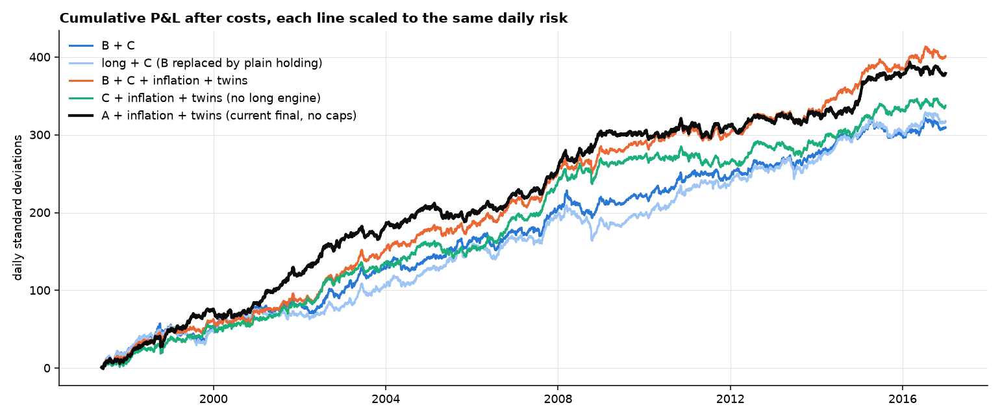

# Engines B and C: performance and robustness

B = Kristofer's EMA 10/100 long-only stretch stop on the 10 stocks and bonds. C = 12-month cross-sectional momentum ranked inside each asset class.
Generated by research/eemil/final_combined/engines_bc.py, do not edit by hand.

## 1. Each engine alone
Scored from 1997-05-22. Every row goes through the same sizing (1/vol, constant ex-ante book risk, 30% glide), so B here is smoother than Kristofer's own on/off backtest. 'bias' is the long tilt: 1 = always long, 0 = balanced.

| model | full | 1997-2002 | 2002-2009 | 2009-2016 | sharpe | sharpe 1d lag | 2x costs | skew | kurt | holding d | bias |
|---|---|---|---|---|---|---|---|---|---|---|---|
| B: Kristofer stop (10 stocks+bonds) | 0.91 | 0.71 | 0.86 | 1.07 | 1.05 | 1.02 | 0.90 | -0.21 | 5.04 | 42.70 | 1.00 |
| always long the same 10 (benchmark for B) | 0.82 | 0.59 | 0.65 | 0.89 | 1.07 | 1.08 | 0.82 | -0.43 | 6.36 | 244.02 | 1.00 |
| C: XS 12m within class | 0.55 | 0.82 | 0.79 | 0.11 | 0.56 | 0.56 | 0.48 | -0.10 | 3.95 | 35.74 | 0.32 |
| C centred (same ranks, class average removed) | 0.39 | 0.98 | 0.50 | -0.14 | 0.39 | 0.38 | 0.31 | -0.04 | 3.94 | 34.63 | 0.02 |
| XS 12m, all 27 ranked together | 0.79 | 1.53 | 0.75 | 0.26 | 0.84 | 0.84 | 0.75 | -0.16 | 4.17 | 42.56 | 0.10 |
| A: trend (Jaakko pick) | 0.82 | 1.57 | 0.73 | 0.40 | 0.88 | 0.87 | 0.80 | -0.14 | 4.41 | 64.83 | 0.08 |
| inflation | 0.72 | 0.52 | 0.92 | 0.41 | 0.76 | 0.78 | 0.69 | -0.02 | 5.30 | 50.92 | 0.02 |
| twins | 0.45 | 0.93 | 0.21 | 0.41 | 0.46 | 0.43 | 0.35 | -0.03 | 4.60 | 31.94 | -0.00 |

## 2. Combinations, one portfolio, equal risk per sleeve
No risk caps unless the row says so. The 'long + ...' rows are the control: the same model with Kristofer's rule swapped for simply holding the same 10 assets. The gap between a B row and its 'long' row is what the stop rule itself adds.

| model | full | 1997-2002 | 2002-2009 | 2009-2016 | sharpe | sharpe 1d lag | 2x costs | skew | kurt | holding d | bias |
|---|---|---|---|---|---|---|---|---|---|---|---|
| B + C | 0.91 | 0.92 | 1.09 | 0.72 | 0.98 | 0.97 | 0.86 | -0.16 | 4.14 | 37.74 | 0.57 |
| long + C (B replaced by plain holding) | 0.88 | 0.82 | 0.93 | 0.88 | 1.01 | 1.01 | 0.85 | -0.27 | 4.83 | 48.89 | 0.67 |
| B + C centred | 0.89 | 1.08 | 1.05 | 0.62 | 0.95 | 0.93 | 0.84 | -0.15 | 4.03 | 34.86 | 0.35 |
| B + C + inflation | 1.03 | 0.74 | 1.33 | 0.80 | 1.17 | 1.16 | 0.99 | -0.21 | 4.40 | 36.78 | 0.45 |
| B + C + inflation + twins | 1.10 | 1.00 | 1.16 | 0.92 | 1.27 | 1.26 | 1.04 | -0.22 | 4.36 | 34.11 | 0.27 |
| long + C + inflation + twins | 1.01 | 1.00 | 0.77 | 1.08 | 1.30 | 1.29 | 0.98 | -0.32 | 5.16 | 37.11 | 0.32 |
| C + inflation + twins (no long engine) | 0.98 | 1.06 | 1.09 | 0.57 | 1.07 | 1.06 | 0.90 | -0.14 | 4.36 | 34.50 | 0.12 |
| A + inflation + twins (current final, no caps) | 1.11 | 1.34 | 1.24 | 0.63 | 1.20 | 1.19 | 1.04 | -0.07 | 4.12 | 38.66 | 0.00 |
| A + C + inflation + twins | 1.06 | 1.37 | 1.20 | 0.54 | 1.17 | 1.16 | 0.99 | -0.12 | 4.28 | 36.84 | 0.12 |
| A + B + C + inflation + twins (all five) | 1.12 | 1.22 | 1.28 | 0.78 | 1.28 | 1.27 | 1.07 | -0.16 | 4.35 | 37.06 | 0.25 |
| B + C + inflation + twins, with risk caps | 0.99 | 1.02 | 1.08 | 0.66 | 1.11 | 1.09 | 0.92 | -0.22 | 4.24 | 33.92 | 0.24 |
| team Dual-Engine as built (50% raw B + 50% C book) | 1.01 | 0.76 | 1.12 | 1.04 | 1.18 | 1.14 | 0.99 | -0.20 | 4.73 | 41.41 | 0.76 |

## 3. Engine B vs plain holding
Regression of B's daily P&L on always-long P&L (same 10 assets, same sizing).

| check | value |
|---|---|
| correlation of B's daily P&L with plain holding | 0.74 |
| beta of B on plain holding | 0.73 |
| Sharpe of what is left after removing holding | 0.39 |
| t-stat of that leftover | 1.70 |
| leftover Sharpe 1997-2002 | 0.44 |
| leftover Sharpe 2002-2009 | 0.58 |
| leftover Sharpe 2009-2016 | 0.11 |

## 4. Mirror world: all price paths flipped upside down
Prices are replaced by 2 x first price minus price, so every rise becomes a fall of the same size and the day-to-day pattern is unchanged. Long/short rules should score about the same. A long-only rule cannot.

| model | real data | mirrored data | bias real | bias mirrored |
|---|---|---|---|---|
| B: Kristofer stop | 0.91 | -0.33 | 1.00 | 1.00 |
| always long the same 10 | 0.82 | -0.82 | 1.00 | 1.00 |
| C: XS 12m within class | 0.55 | 0.15 | 0.32 | 0.28 |
| C centred | 0.39 | 0.39 | 0.02 | -0.02 |
| A: trend | 0.82 | 0.82 | 0.08 | -0.08 |
| B + C | 0.91 | -0.09 | 0.57 | 0.45 |
| A + C | 0.76 | 0.56 | 0.23 | 0.16 |

## 5a. Engine B: neighbouring settings
If the score only holds at one setting, the setting was fitted.

| engine B setting | model | full | 1997-2002 | 2002-2009 | 2009-2016 |
|---|---|---|---|---|---|
| default: EMA 10/100, gap 8 | B alone | 0.91 | 0.71 | 0.86 | 1.07 |
| default: EMA 10/100, gap 8 | B + C | 0.91 | 0.92 | 1.09 | 0.72 |
| gap 6 | B alone | 0.88 | 0.66 | 0.87 | 1.04 |
| gap 6 | B + C | 0.88 | 0.91 | 1.11 | 0.63 |
| gap 10 | B alone | 0.92 | 0.76 | 0.86 | 1.06 |
| gap 10 | B + C | 0.90 | 0.93 | 1.06 | 0.72 |
| no stop | B alone | 0.90 | 0.74 | 0.86 | 1.05 |
| no stop | B + C | 0.90 | 0.91 | 1.05 | 0.72 |
| EMA 20/100 | B alone | 0.90 | 0.77 | 0.84 | 1.04 |
| EMA 20/100 | B + C | 0.88 | 0.95 | 1.03 | 0.69 |
| EMA 10/200 | B alone | 0.80 | 0.54 | 0.84 | 0.91 |
| EMA 10/200 | B + C | 0.85 | 0.84 | 1.06 | 0.64 |
| EMA 5/50 | B alone | 0.87 | 0.74 | 0.83 | 1.00 |
| EMA 5/50 | B + C | 0.86 | 0.87 | 1.02 | 0.67 |

## 5b. Engine C: neighbouring lookbacks

| lookback d | model | full | 1997-2002 | 2002-2009 | 2009-2016 |
|---|---|---|---|---|---|
| 60 | C alone | -0.07 | -0.22 | 0.17 | -0.22 |
| 60 | B + C | 0.55 | 0.25 | 0.70 | 0.57 |
| 120 | C alone | 0.13 | 0.19 | 0.25 | -0.04 |
| 120 | B + C | 0.68 | 0.53 | 0.77 | 0.70 |
| 190 | C alone | 0.33 | 0.72 | 0.44 | -0.05 |
| 190 | B + C | 0.76 | 0.81 | 0.82 | 0.68 |
| 250 | C alone | 0.55 | 0.82 | 0.79 | 0.11 |
| 250 | B + C | 0.91 | 0.92 | 1.09 | 0.72 |
| 310 | C alone | 0.34 | 0.54 | 0.70 | -0.18 |
| 310 | B + C | 0.81 | 0.78 | 1.05 | 0.57 |
| 375 | C alone | 0.22 | 0.25 | 0.71 | -0.34 |
| 375 | B + C | 0.75 | 0.65 | 1.04 | 0.50 |

## 6. Leak test
Positions recomputed on histories cut at 30 / 50 / 70 / 90 / 97% must equal the full run.

| model | result | largest relative difference |
|---|---|---|
| B | PASS | 0.0e+00 |
| C | PASS | 0.0e+00 |
| B + C | PASS | 0.0e+00 |

## 7. Block bootstrap of the differences
2000 paired resamples of 60-day blocks of daily P&L.

| model | against | model score | against score | difference | 90% interval of difference | P(model wins) |
|---|---|---|---|---|---|---|
| B + C | long + C (B replaced by plain holding) | 0.91 | 0.88 | 0.03 | -0.14 to 0.20 | 0.60 |
| B + C + inflation + twins | long + C + inflation + twins | 1.10 | 1.01 | 0.08 | -0.08 to 0.26 | 0.74 |
| B + C + inflation + twins | A + inflation + twins (current final, no caps) | 1.10 | 1.11 | -0.01 | -0.23 to 0.23 | 0.48 |
| A + C + inflation + twins | A + inflation + twins (current final, no caps) | 1.06 | 1.11 | -0.05 | -0.19 to 0.10 | 0.30 |
| C + inflation + twins (no long engine) | A + inflation + twins (current final, no caps) | 0.98 | 1.11 | -0.13 | -0.36 to 0.10 | 0.17 |

## 8. P&L correlation between engines

| daily P&L | B | long | C | A trend | inflation | twins |
|---|---|---|---|---|---|---|
| B | 1.00 | 0.74 | 0.32 | 0.52 | 0.01 | -0.01 |
| long | 0.74 | 1.00 | 0.34 | 0.32 | 0.01 | 0.00 |
| C | 0.32 | 0.34 | 1.00 | 0.60 | -0.03 | -0.05 |
| A trend | 0.52 | 0.32 | 0.60 | 1.00 | -0.06 | -0.03 |
| inflation | 0.01 | 0.01 | -0.03 | -0.06 | 1.00 | 0.01 |
| twins | -0.01 | 0.00 | -0.05 | -0.03 | 0.01 | 1.00 |
