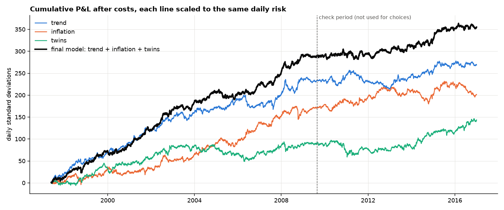

# Final model results

Data: close_prices_insample.csv + macro_data_insample.csv, 27 assets, 1995-01-02 to 2016-12-30. Score: Lynx evaluation.py (2-day lag, 0.02 sigma costs).
Generated by research/eemil/final_combined/final_validation.py, do not edit by hand.

## 1. Models (adjusted Sharpe unless the column says otherwise)
All rows are scored from 1997-05-22, the first day every sleeve holds a position, so the eras compare like with like. The first era is therefore 1997-05-22 to 2002-05-01. 'full', the three eras and '2x costs' are adjusted Sharpe. All rows except the last two use the same risk caps (twin legs share one budget, bond block capped at 2 bets, ultrapure_silicon half weight). The last three rows are for reference only.

| model | full | 1997-2002 | 2002-2009 | 2009-2016 | sharpe | sharpe 1d lag | 2x costs | skew | kurt | holding d | bias |
|---|---|---|---|---|---|---|---|---|---|---|---|
| Lynx 50d baseline | 0.32 | -0.07 | 0.55 | 0.28 | 0.32 | 0.20 | 0.19 | 0.14 | 6.28 | 15.85 | 0.02 |
| trend only | 0.78 | 1.44 | 0.75 | 0.30 | 0.85 | 0.85 | 0.76 | -0.22 | 4.72 | 64.66 | 0.05 |
| inflation only | 0.61 | 0.47 | 0.88 | 0.26 | 0.64 | 0.66 | 0.58 | -0.06 | 5.30 | 50.99 | 0.02 |
| trend + inflation | 0.87 | 1.00 | 1.09 | 0.26 | 0.94 | 0.95 | 0.84 | -0.14 | 4.44 | 57.15 | -0.01 |
| trend + inflation + twins (FINAL) | 1.06 | 1.43 | 1.20 | 0.53 | 1.13 | 1.12 | 0.98 | -0.07 | 3.90 | 38.55 | 0.01 |
| final + Kristofer stop overlay | 1.10 | 1.74 | 1.22 | 0.53 | 1.15 | 1.16 | 1.01 | -0.02 | 3.82 | 37.66 | -0.00 |
| twins only | 0.45 | 0.93 | 0.21 | 0.41 | 0.46 | 0.43 | 0.35 | -0.03 | 4.60 | 31.94 | -0.00 |
| final, no risk caps | 1.11 | 1.34 | 1.24 | 0.63 | 1.20 | 1.19 | 1.04 | -0.07 | 4.12 | 38.66 | 0.00 |
| Jaakko pick as is (trend, no caps) | 0.82 | 1.57 | 0.73 | 0.40 | 0.88 | 0.87 | 0.80 | -0.14 | 4.41 | 64.83 | 0.08 |

## 2. The one choice made on data: twins in or out
Rule fixed up front: keep the twins sleeve only if it raises adjusted Sharpe on 1997-05-22 to 2009-08-28. The last era is not used. Result: **trend + inflation + twins** is the final model.

| model | 1997-2009 |
|---|---|
| trend + inflation | 1.12 |
| trend + inflation + twins | 1.30 |

## 3. P&L correlation between sleeves
Each sleeve run alone through the same sizing.

| daily P&L | trend only | inflation only | twins only | final model |
|---|---|---|---|---|
| trend only | 1.00 | -0.10 | -0.03 | 0.49 |
| inflation only | -0.10 | 1.00 | 0.02 | 0.48 |
| twins only | -0.03 | 0.02 | 1.00 | 0.62 |
| final model | 0.49 | 0.48 | 0.62 | 1.00 |

## 4. Inflation lookback plateau
CPI lookback k for bonds in {20, 60, 120} and for stocks in {120, 250}. The defaults (60, 120) were fixed before this table was made and stay whatever it shows. The table only checks that the neighbours score about the same.

| bonds k | stocks k | model | default | full | 1997-2002 | 2002-2009 | 2009-2016 |
|---|---|---|---|---|---|---|---|
| 20 | 120 | inflation only |  | 0.54 | 0.40 | 0.81 | 0.19 |
| 20 | 120 | trend + inflation |  | 0.87 | 0.98 | 1.12 | 0.27 |
| 60 | 120 | inflation only | yes | 0.61 | 0.47 | 0.88 | 0.26 |
| 60 | 120 | trend + inflation | yes | 0.87 | 1.00 | 1.09 | 0.26 |
| 120 | 120 | inflation only |  | 0.59 | 0.67 | 0.65 | 0.44 |
| 120 | 120 | trend + inflation |  | 0.85 | 1.06 | 0.98 | 0.21 |
| 60 | 250 | inflation only |  | 0.46 | 0.14 | 0.90 | 0.18 |
| 60 | 250 | trend + inflation |  | 0.85 | 1.12 | 1.03 | 0.35 |
| 60 | - | bonds rule alone, k=60 |  | 0.39 | -0.04 | 0.95 | -0.03 |
| - | 120 | stocks rule alone, k=120 |  | 0.42 | 0.49 | 0.68 | 0.10 |

## 5. Leak test
Positions recomputed on histories cut at 30 / 50 / 70 / 90 / 97% (prices and macro both cut) must equal the full run on every shared row.

| model | result | largest relative difference |
|---|---|---|
| trend + inflation + twins (final) | PASS | 0.0e+00 |
| inflation only | PASS | 0.0e+00 |

## 6. Block bootstrap: final model vs trend only
2000 paired resamples of 60-day blocks of daily P&L. P(final beats trend only) = **0.94**.

| quantity | point | 90% interval |
|---|---|---|
| final model | 1.06 | 0.75 to 1.37 |
| trend only | 0.78 | 0.44 to 1.08 |
| final minus trend only | 0.28 | -0.02 to 0.57 |
