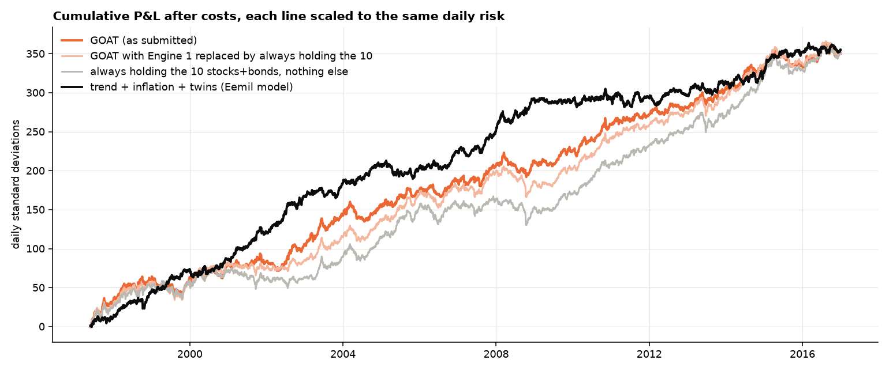

# GOAT model audit

GOAT = 60% Kristofer stretch stop on 10 stocks and bonds + 40% cross-sectional 12-month momentum, glide and deadband (src/goat_model.py).
Generated by research/eemil/final_combined/goat_audit.py, do not edit by hand.

## 1. Scores, same window and evaluator for every row
Scored from 1997-05-22 like the other tables in this folder. 'bias' is the long tilt: 1 = always long, 0 = balanced.

| model | full | 1997-2002 | 2002-2009 | 2009-2016 | sharpe | sharpe 1d lag | 2x costs | skew | kurt | holding d | bias |
|---|---|---|---|---|---|---|---|---|---|---|---|
| GOAT (as submitted) | 1.02 | 0.88 | 1.12 | 1.01 | 1.11 | 1.10 | 0.99 | -0.12 | 4.18 | 60.27 | 0.63 |
| GOAT with the stop removed (EMA 10/100 long or flat) | 0.97 | 0.84 | 1.06 | 0.98 | 1.07 | 1.06 | 0.95 | -0.15 | 4.43 | 68.27 | 0.64 |
| GOAT with Engine 1 replaced by always holding the 10 | 0.98 | 0.80 | 0.95 | 1.11 | 1.13 | 1.12 | 0.97 | -0.23 | 4.64 | 121.75 | 0.75 |
| GOAT Engine 1 alone (stop, 10 stocks+bonds) | 0.96 | 0.68 | 0.93 | 1.12 | 1.13 | 1.12 | 0.95 | -0.21 | 5.04 | 61.12 | 1.00 |
| always holding the 10 stocks+bonds, nothing else | 0.92 | 0.65 | 0.79 | 0.98 | 1.11 | 1.12 | 0.92 | -0.30 | 5.24 | 811.36 | 1.00 |
| GOAT Engine 2 alone (XS momentum) | 0.57 | 0.80 | 0.76 | 0.20 | 0.58 | 0.58 | 0.53 | -0.07 | 3.91 | 55.94 | 0.31 |
| GOAT Engine 2 alone, ranks centred (true long/short) | 0.37 | 0.90 | 0.43 | -0.10 | 0.37 | 0.36 | 0.32 | -0.04 | 4.00 | 53.78 | 0.01 |
| GOAT with Engine 2 centred | 1.02 | 1.01 | 1.05 | 1.01 | 1.11 | 1.11 | 1.00 | -0.11 | 4.14 | 55.81 | 0.47 |
| trend + inflation + twins (Eemil model) | 1.06 | 1.43 | 1.20 | 0.53 | 1.13 | 1.12 | 0.98 | -0.07 | 3.90 | 38.55 | 0.01 |

## 1b. GOAT on the whole file (1995 to 2016), as in the README

| figure | value |
|---|---|
| adjusted_sharpe | 1.14 |
| sharpe | 1.32 |
| sharpe_1d_lag | 1.31 |
| kurtosis | 4.33 |
| av_holding | 61.55 |
| position_bias | 0.64 |

## 2. How much of GOAT is simply being long stocks and bonds?

| check | value |
|---|---|
| correlation of GOAT's daily P&L with plain holding of the 10 | 0.71 |
| share of GOAT's P&L variance explained by plain holding (R2) | 0.50 |
| Sharpe of what is left after removing holding | 0.46 |
| t-stat of that leftover | 2.04 |
| leftover Sharpe 1997-2002 | 0.56 |
| leftover Sharpe 2002-2009 | 0.83 |
| leftover Sharpe 2009-2016 | -0.02 |
| share of GOAT's total P&L earned on stocks and bonds | 0.87 |
| share of GOAT's P&L variance from stocks and bonds | 0.79 |

## 3. Mirror world: what if stocks and bonds had fallen instead of risen?
Each price is replaced by (first price)^2 / price, so every rise becomes a fall of the same size. A rule with a real edge in both directions keeps most of its score. A rule that lives on the market going up does not.

| model | real data | mirrored data | bias real | bias mirrored |
|---|---|---|---|---|
| GOAT (as submitted) | 1.02 | 0.13 | 0.63 | 0.52 |
| GOAT with Engine 1 replaced by always holding the 10 | 0.98 | -0.47 | 0.75 | 0.75 |
| GOAT Engine 1 alone | 0.96 | -0.04 | 1.00 | 1.00 |
| GOAT Engine 2 alone | 0.57 | 0.28 | 0.31 | 0.31 |
| Jaakko's trend pick (long/short, for comparison) | 0.82 | 0.87 | 0.08 | -0.07 |

## 4. One setting changed at a time

| setting | full | 1997-2002 | 2002-2009 | 2009-2016 |
|---|---|---|---|---|
| as submitted: gap 7, 60/40, glide 25%, deadband 10%, 252d | 1.02 | 0.88 | 1.12 | 1.01 |
| gap 6 | 1.00 | 0.83 | 1.16 | 0.94 |
| gap 8 (Kristofer's original) | 1.01 | 0.85 | 1.12 | 1.00 |
| gap 10 | 0.98 | 0.88 | 1.07 | 0.97 |
| blend 50/50 | 0.98 | 0.90 | 1.12 | 0.90 |
| blend 70/30 | 1.02 | 0.84 | 1.08 | 1.07 |
| blend 40/60 | 0.92 | 0.91 | 1.06 | 0.79 |
| glide 10% | 0.97 | 0.86 | 1.05 | 0.96 |
| glide 100% (none) | 0.98 | 0.71 | 1.13 | 1.00 |
| deadband off | 1.01 | 0.87 | 1.12 | 1.00 |
| deadband 5% | 1.02 | 0.88 | 1.12 | 1.01 |
| deadband 20% | 0.99 | 0.82 | 1.10 | 0.97 |
| XS lookback 190d | 0.88 | 0.75 | 0.92 | 0.92 |
| XS lookback 310d | 0.96 | 0.79 | 1.11 | 0.91 |

## 5. Forward-looking bias

| test | result | largest difference |
|---|---|---|
| shorter history (cut at 30/50/70/90/97%) | PASS | 0.0e+00 |
| future replaced by random data after 30/50/70/90% | PASS | 0.0e+00 |
| first 15 days only vs full run (the vol is back-filled over the first 20 days) | FAIL | 3.6e+02 |

## 6. Risk: stable over time, spread across assets?
Risk = rolling 1-year standard deviation of daily P&L divided by its median.

| model | risk, lowest year vs normal | risk, highest year vs normal | variance share stocks+bonds (37% if even) | variance share top 5 assets (19% if even) | assets with positive P&L | worst calendar year Sharpe |
|---|---|---|---|---|---|---|
| GOAT (as submitted) | 0.81 | 1.39 | 0.79 | 0.49 | 18 of 27 | 0.13 |
| trend + inflation + twins (Eemil model) | 0.75 | 1.30 | 0.41 | 0.40 | 23 of 27 | -0.27 |

## 7. Block bootstrap of the differences
2000 paired resamples of 60-day blocks. P&L correlation GOAT vs Eemil model: 0.32.

| model | against | difference | 90% interval | P(model wins) |
|---|---|---|---|---|
| GOAT (as submitted) | trend + inflation + twins (Eemil model) | -0.04 | -0.40 to 0.32 | 0.43 |
| GOAT (as submitted) | GOAT with Engine 1 replaced by always holding the 10 | 0.04 | -0.14 to 0.21 | 0.66 |
| GOAT (as submitted) | GOAT with the stop removed (EMA 10/100 long or flat) | 0.05 | -0.01 to 0.13 | 0.92 |

## 8. For information: the two models together
A sum of the two daily P&Ls, not one portfolio. Shows whether they are different bets.

| model | full | 1997-2002 | 2002-2009 | 2009-2016 |
|---|---|---|---|---|
| 50/50 of the two models' P&L, same risk each | 1.22 | 1.35 | 1.32 | 0.96 |
